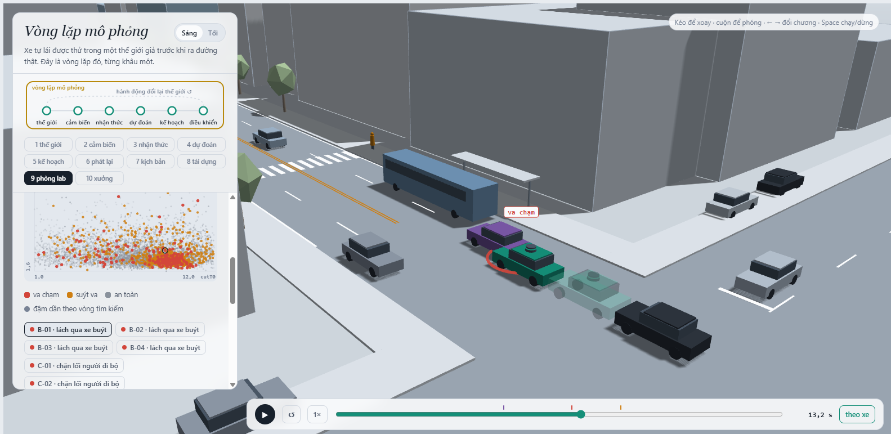
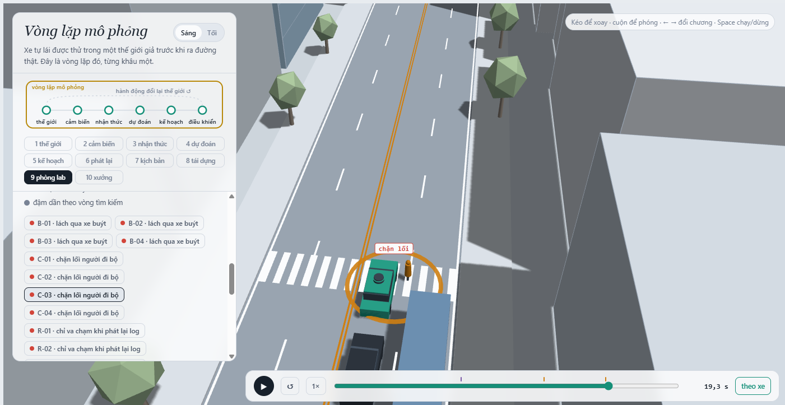
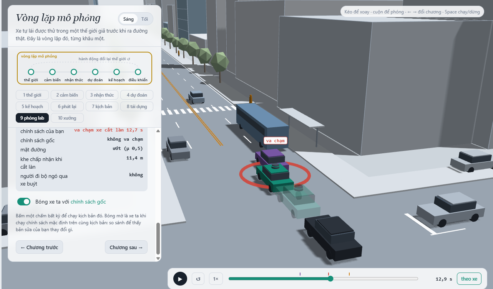
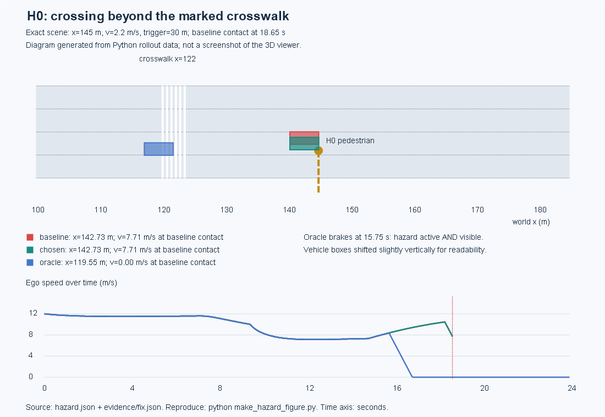
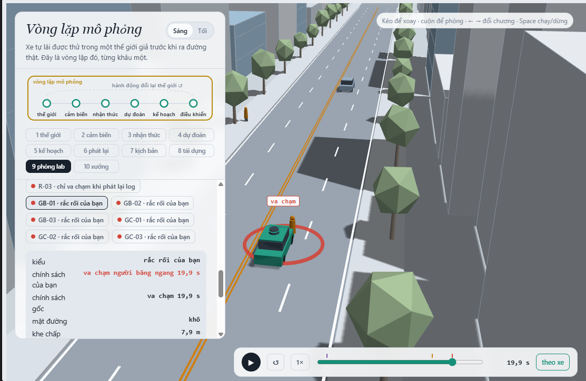

MSSV: 202602920

# Lab 11 · Scenario Forge — báo cáo

Các số dưới đây lấy từ lần chạy đầy đủ trong `evidence/`, không dùng `--quick`. Bước G được chạy bổ sung sau pipeline chính; các phép thử thiết kế cảnh được ghi riêng, không gộp vào xác suất của lần quét cuối.

Thị trấn của bạn (`meta.json: _run.town`): **B**.

## 1. Phát lại log có trung thực không? (bước A)

Theo `replay.json`, có 400 kịch bản ban đầu; bỏ 1 kịch bản vì người lái trong log đã va chạm, còn 399 kịch bản được dùng. Planner trên log phát lại có 116 va chạm: 104 `rear` và 12 `side`. Trong thế giới phản ứng có 2 va chạm, đều `side`; có 1 kịch bản va chạm ở cả hai cách (`crash_in_both = 1`).

Phần lớn va chạm replay là `rear` vì các xe khác chạy đúng quỹ đạo đã ghi và không phản ứng với việc ego planner phanh sớm hoặc thay đổi tốc độ. Xe phía sau tiếp tục chạy theo log cũ nên đâm vào ego; đó là va chạm giả của môi trường replay, không phải hành vi tương tác nhất quán của thế giới. Ví dụ `replay_only[0]` (`scenario = 4`) là va chạm `rear`, trong khi rollout phản ứng không va chạm và có `min_ttc_reactive ≈ 2.703 s`.

## 2. Kịch bản bất khả thi (bước B)

`is_feasible` loại bốn nhóm tình huống: (1) gia tốc ngang cực đại của chuyển làn, `(pi / cutDur)^2 * 3.5 / 2`, không được vượt `mu * g`; (2) phanh sau nhập làn `cutBrake` không được vượt `mu * g`; (3) tốc độ người đi bộ `pedV` không được lớn hơn 2.5 m/s; (4) tốc độ xe cắt làn phải thuộc `(0, 22] m/s`. Hai luật đầu là giới hạn bám đường và gia tốc do ma sát; hai luật sau loại hành vi không thực tế.

Trong `hunt.json`, cuộc săn `crosswalk_block` bỏ qua nhiều mẫu bất khả thi nhất: 10 mẫu, so với 5 của `bus_bypass`, 3 của `cut_in` và 3 của `rear_ended`. CEM ưu tiên các mẫu có điểm nguy hiểm cao; nếu không lọc, các mẫu vật lý không thể xảy ra có thể có điểm rất nguy hiểm và kéo proposal về vùng đó. Đếm chúng là va chạm sẽ làm xác suất bị thổi phồng và làm policy/hunt tối ưu sai.

## 3. Monte Carlo cho bạn biết gì (bước C1)

Theo `mc.json`, `k = 3`, `n = 3000`, nên `p̂ = 0.001`. Khoảng Wilson 95% là `[0.0003401411, 0.0029361968]` (xấp xỉ `[3.40e-4, 2.94e-3]`). Với xấp xỉ `n ≈ 1.96²(1-p)/(0.2²p) ≈ 96/p`, để sai số khoảng còn ±20% của `p` cần khoảng `96,000` lần chạy.

Monte Carlo chỉ thấy `bus_bypass` (3 lần). `cut_in`, `crosswalk_block`, `rear_ended` và `other` không xuất hiện, nhưng không được kết luận xác suất bằng 0. Mỗi kiểu này có cận trên Wilson 95% `mc.json: per_mode.<mode>.hi = 0.0012788957` (khoảng 0.128%). Monte Carlo lấy mẫu trực tiếp từ phân phối tự nhiên, nên không dùng hệ số 0.2 của defensive importance sampling; trường `upper_zero_hits` thuộc bước IS, không có trong `mc.json`.

## 4. Importance sampling, ESS và độ suy biến (bước C3)

`estimate.json` dùng ngân sách `16,800` rollout. Bảng dưới ghi các giá trị chính (p làm tròn):

| Seed | Kiểu | p | hits | ESS | top_share |
|---|---|---:|---:|---:|---:|
| 0 | bus_bypass | 5.59e-4 | 27 | 149.19 | 0.692 |
| 0 | cut_in | 0 | 0 | 127.86 | 0 |
| 0 | crosswalk_block | 2.05e-6 | 100 | 112.02 | 0.109 |
| 0 | rear_ended | 0 | 0 | 121.52 | 0 |
| 1 | bus_bypass | 5.14e-4 | 27 | 149.02 | 0.571 |
| 1 | cut_in | 0 | 0 | 119.14 | 0 |
| 1 | crosswalk_block | 5.84e-5 | 111 | 129.55 | 0.800 |
| 1 | rear_ended | 0 | 0 | 114.33 | 0 |
| 2 | bus_bypass | 7.92e-4 | 35 | 135.89 | 0.370 |
| 2 | cut_in | 0 | 0 | 124.34 | 0 |
| 2 | crosswalk_block | 3.33e-5 | 103 | 121.48 | 0.559 |
| 2 | rear_ended | 0 | 0 | 120.25 | 0 |

Các ESS và `top_share` ở trên được lấy từ `estimate.json`; các ESS được làm tròn đến hai chữ số. Các số 0 trong cột `p` chỉ là point estimate do không có hit, không phải khẳng định xác suất thật bằng 0. Ba seed tương đối đồng ý về `bus_bypass`, nhưng `crosswalk_block` dao động khoảng 28.6 lần giữa seed 0 và seed 1. Tổng của ba seed lần lượt là `5.6139e-4`, `5.7202e-4`, `8.2569e-4`, đều nằm trong khoảng Wilson của MC `[3.4014e-4, 2.9362e-3]`; dữ liệu chưa cho thấy mâu thuẫn rõ, nhưng cũng chưa chứng minh IS chính xác. `top_share > 0.5` xuất hiện ở `bus_bypass` seed 0–1 và `crosswalk_block` seed 1–2. Khi top share lớn, một mẫu có trọng số lớn quyết định phần lớn ước lượng, nên khoảng xấp xỉ có thể không ổn định. `cut_in` và `rear_ended` không có hit; phải báo cận `upper_zero_hits = 0.025` của mỗi seed, không kết luận xác suất bằng 0. Khoảng `total.lo/hi` do pipeline xuất là khoảng xấp xỉ; nó chưa cộng hai cận zero-hit này, nên không được dùng như chứng nhận cho toàn bộ các mode.

Phần `other` lấy từ Monte Carlo (`other.k = 0`, `other.n = 3000`, `other.p = 0`, `other.hi ≈ 0.0012789` trong `estimate.json`), vì `other` không phải một failure mode đủ cụ thể để CEM định nghĩa score và săn riêng. Ngân sách `estimate.json: budget = 16,800` gồm 9,600 mẫu săn CEM và 7,200 mẫu IS của ba seed; chưa tính 3,000 mẫu MC dùng cho `other`. Với `p ≈ 0.001`, MC cần khoảng 96,000 mẫu để đạt sai số tương đối ±20% ở mức 95%, gấp 5.71 lần ngân sách 16,800. Đây chỉ là so sánh ngân sách với mục tiêu độ chính xác: IS hiện tại chưa chứng minh đạt ±20%, vì các seed và trọng số còn biến động mạnh. Không thể từ tỷ số 5.71 suy ra tốc độ cải thiện ở cùng độ chính xác.

## 5. Các kiểu thất bại (bước C2 + 3D)

Hai kiểu mục tiêu được tìm thấy là `bus_bypass` và `crosswalk_block`. Với `bus_bypass`, C2 giảm tốc và lấn sang làn ego để lách xe buýt đang dừng; baseline chỉ coi C2 là xe dẫn khi nó đã lấn đủ gần, phanh muộn rồi va chạm. Với `crosswalk_block`, người đi bộ xuất hiện từ vùng bị xe buýt che; ego phanh nhưng thân xe vẫn nằm trên vạch, chặn đường người đi bộ. Người đi bộ đứng lại trước thân xe, nên `block` là thất bại chặn lối, không phải họ đi xuyên vào xe.

Ảnh C-03 tại 19.3 s hiển thị vòng đánh dấu và nhãn “chặn lối”, ngay sau sự kiện `block` ở frame 381, tức 19.05 s (`hazard_js_parity.json: comparisons[3]`).

Cuộc săn nhắm `cut_in` và `rear_ended` không tìm thấy đúng mode đó trong `found` (các rollout có thể chứa mode khác). Vì vậy chưa thể khẳng định hai mode này không tồn tại; chỉ có thể nói chúng không được tìm thấy với ngân sách/cuộc săn này. Nếu chỉ chạy một cuộc săn chung, CEM bị kéo về vùng có score dễ tối ưu nhất, thường là một mode; các mode khác sẽ bị bỏ sót. Đây là lý do `hunt.json` chạy riêng cho từng mode.

## 6. Sửa planner (bước E + 3D)

Policy được chọn trên TRAIN là `{"cutinLat": 3.0}`. Theo log chạy đầy đủ, TRAIN có `fail = 4.91e-06`, `fail_hi = 1.01e-05`, progress `210.1 m`. Trên TEST, policy chọn có `fail = 1.08e-04`, `fail_hi_seen = 3.15e-04`, `fail_hi = 3.91e-02`, progress `213.4 m`. Baseline TEST có `fail = 5.43e-04`, `fail_hi_seen = 8.81e-04`, `fail_hi = 2.16e-03`, progress `213.3 m` (các số này lấy từ `fix.json`/log lần chạy đầy đủ).

Policy mới giảm failure point estimate và giữ progress gần như không đổi, nhưng `fail_hi` mà pipeline dùng cho toàn policy lại lớn hơn baseline vì policy mới chưa thấy `bus_bypass`; cận `upper_zero_hits = 3/(0.2*400) = 0.0375` của mode chưa thấy được cộng vào. Đây là khác biệt giữa `fail_hi_seen` và cận có tính cả mode chưa thấy. Các khoảng của mode có hit vẫn là xấp xỉ IS, nên kết quả chưa phải chứng nhận an toàn tuyệt đối. Số frame phanh gấp trung bình mỗi kịch bản (`fix.json: chosen_test.harsh`) là `8.3047`, so với `baseline_test.harsh = 8.9290`; đây là số frame gia tốc dưới −3 m/s², không phải số đợt phanh độc lập.

Ảnh được chụp từ run săn có policy baseline được gắn cố định trong `viewer.json`. Theo `viewer/app.js: labPlay`, ở các run B/C này xe chính là baseline (`cutinLat = 2.15`), bóng mờ là bản sửa (`cutinLat = 3.0`); nhãn “chính sách của bạn/chính sách gốc” trong giao diện bị đảo vai so với policy thực tế. Bản sửa nhận C2 đang lấn làn sớm hơn và tránh được va chạm trong ví dụ này. Với chấm trên cloud không gắn policy, bóng mờ mới là baseline.

`cautionV` là trần tốc độ khi thận trọng, nên tăng nó không phải tăng mức an toàn. Trong `fix.json: table`, giảm `cautionV` từ 7.5 xuống 5.0 làm TRAIN fail giảm từ `7.8756e-4` xuống `6.0874e-5`, nhưng progress giảm từ `210.3562` xuống `171.6395 m`, vượt giới hạn mất 5%; một thay đổi thận trọng vẫn có chi phí vận hành lớn. Các ứng viên hiện có chưa đủ để khẳng định tăng headway gây tăng failure. Về cơ chế, phanh sớm có thể đổi khe mà C2 chấp nhận hoặc khiến xe sau phải phanh, nên cần kiểm tra trong thế giới phản ứng thay vì suy luận chỉ từ ý nghĩa núm. Không đổi ứng viên hay chọn lại policy từ dữ liệu TEST/G.

## 7. Từ mô phỏng ra đường thật

Ba giả định quan trọng là:

1. **Khe chấp nhận của xe chuyển làn (`cutGap`)**: thay bằng trajectory từ camera giao thông, dữ liệu fleet và các lần nhập làn đã được gán nhãn. Nếu tài xế thật nhận khe nhỏ hơn mô phỏng, tần suất `cut_in`/`bus_bypass` có thể bị đánh giá thấp.
2. **Người đi bộ có nhìn qua xe buýt (`pedLook`) và thời điểm bước xuống đường**: thay bằng video giao lộ, quan sát hành vi theo hướng nhìn/khuất tầm mắt và dữ liệu crossing. Nếu mô phỏng cho người đi bộ nhìn quá thường xuyên hoặc quá sớm, xác suất `crosswalk_block` bị đánh giá thấp.
3. **Ma sát đường ướt (`wet`, `mu`)**: thay bằng dữ liệu thời tiết, cảm biến mặt đường và log phanh có đo gia tốc. Nếu thực tế trơn hơn giả định, cả khả năng tránh của ego và feasibility của xe khác bị đánh giá quá lạc quan, nên xác suất va chạm thực tế cao hơn.

## 8. Giới hạn

Xác suất này không nói rằng kết quả đúng cho mọi thành phố vì mô phỏng chỉ có một bản đồ/giao lộ. Nó cũng không đại diện đầy đủ cho người lái thật vì các xe khác chủ yếu dùng IDM và một số luật phản ứng đơn giản. Ngoài ra cảm biến gần như hoàn hảo: chưa có mô hình sai số phát hiện/phân loại do mưa, ánh sáng hay cảm biến; đường ướt chỉ thay đổi hệ số ma sát. Xe đạp, xe chết máy và người băng ngang có thể được thêm bằng hazard ở chương 10, nhưng không tự có trong phân phối tự nhiên dùng cho MC/IS. Nếu có thêm một tuần, tôi sẽ thu thập trajectory thực tế ở nhiều giao lộ, gán nhãn che khuất và hành vi nhường đường, sau đó hiệu chỉnh lại các phân phối `cutGap`, `pedLook`, `mu` và kiểm tra trên các bản đồ chưa thấy.

## 9. Rắc rối của bạn (bước G + chương 10)

**Rắc rối và giả thuyết.** H0 là người đi bộ băng từ lề nam qua đường ở ngoài vạch, tại `x = 145 m`, sau vạch chính `x = 122 m` một đoạn 23 m. Họ bắt đầu khi ego còn cách 30 m, đi với tốc độ 2.2 m/s. Đây là kiểm thử người đi nhanh, không phải hành vi đi bộ trung bình. Planner có logic dự đoán và nhường riêng cho P1 ở vạch chính (`avsim/core.py`), còn H0 chủ yếu được xử lý khi đã thành vật cản trong hành lang xe. Giả thuyết là bản sửa `cutinLat` giúp nhận xe lấn làn nhưng không sửa khả năng dự đoán người băng ngang ngoài vạch.

**Thiết kế và căn cứ.** `hazard.json` dùng đúng định dạng `avsim-studio/1`, có thể nạp ở chương 10. Cảnh cụ thể được tìm bằng một phép thử thiết kế riêng gồm 36 tổ hợp; chúng không được tính vào kết quả quét cuối. `space` lấy đều `h0_x ∈ [140,160] m`, `h0_v ∈ [1.8,2.4] m/s`, `h0_trig ∈ [26,36] m`; đây là miền thử kỹ thuật khai báo trước khi chạy `mine`, không phải phân phối hành vi đã hiệu chỉnh từ thực tế. Miền vị trí nằm sau vạch 18–38 m. Từ lề `z=9.2` đến tâm làn ego `z=1.75` là 7.45 m, tương ứng thời gian đi 3.10–4.14 s trong miền tốc độ trên; khoảng kích hoạt 26–36 m tương ứng thời gian ego tới nơi 2.17–4.50 s nếu chạy 8–12 m/s. Hai cửa sổ giao nhau, đủ kiểm tra xung đột thời gian mà không ép cảnh bất khả thi. Các giá trị đều nằm trong `studio.LIMITS`.

`world = "town"` giữ giao thông xung quanh lấy từ phân phối thị trấn B. `exposure = 1` xuất phát từ quy trình thử: **mỗi chuyến thử được bố trí đúng một H0**. Đây là tần suất do thiết kế tập thử, không phải số liệu tần suất trên đường công cộng. `why` ghi đầy đủ phép tính và giới hạn này; chưa có dữ liệu để quy đổi thành rủi ro tự nhiên ngoài đường. Để làm việc đó phải đếm số lần gặp người băng ngang tương tự trên tổng số chuyến của tuyến triển khai, rồi thay exposure bằng tần suất đo được.

**Cảnh cụ thể.** `mine.json: exact.planner = [["ego","H0",18.65]]`. Kiểm tra bổ sung trong `hazard_scene.json` cho thấy cả baseline và `cutinLat = 3.0` đều tiếp xúc H0 ở 18.65 s, ego còn chạy khoảng 7.71 m/s. Oracle bắt đầu phanh tại 15.75 s, khi H0 đã hoạt động và nhìn thấy, rồi dừng mà không va chạm; do đó cảnh này là `avoidable`. `hazard_js_parity.json` đối chiếu cả hai policy với lõi JS thuần: trạng thái chuyển động, trạng thái planner và sự kiện đều khớp, sai số lớn nhất bằng 0.

Đây là sơ đồ từ dữ liệu mô phỏng, **không phải ảnh chụp viewer 3D**. Bản vector ở `evidence/shots/hazard_trajectory.svg`; chạy `python make_hazard_figure.py` để tạo lại SVG và `hazard_scene.json`.

Ảnh 3D dùng run `GB-01` trong `viewer.json`, là một biến thể `avoidable` lấy từ `mine.json: baseline.examples`, không phải cảnh cố định 18.65 s ở trên. Timeline khoảng 19.9 s trùng thời điểm tiếp xúc của biến thể này; cả hai policy đều va chạm. Run gắn baseline cho xe chính và bản sửa cho bóng mờ, tương tự các run B/C. Tách rõ hai cảnh để không gán nhầm thời điểm hoặc tham số của biến thể cho `mine.json: exact`.

**Kết quả quét đầy đủ.** Chạy `python run_all.py mine hazard.json` với 1,500 mẫu, không dùng `--quick`. `mine.json: accepted = 0.992` (99.2%): giữ 1,488, loại 12 mẫu bất khả thi; không có chồng lấn hazard lúc bắt đầu (`overlap_at_start = 0` ở cả hai policy).

| Trường trong `mine.json` | Baseline | Chosen: `cutinLat = 3.0` |
|---|---:|---:|
| `n` | 1488 | 1488 |
| `crashes` | 313 | 312 |
| `avoidable` | 309 | 309 |
| `unavoidable` | 2 | 2 |
| `unattributed` | 2 | 1 |
| `low_speed` (cờ bổ sung) | 2 | 2 |
| `avoidable_foreknown` | 309 | 309 |
| `p` = `avoidable/n` | 0.2076613 | 0.2076613 |
| Wilson 95% `[lo,hi]` | [0.1878164, 0.2290118] | [0.1878164, 0.2290118] |

Hai policy đều có khoảng **20.77% lỗi planner có thể tránh bằng phanh trong miền hazard này**. Một va chạm tổng cộng ít hơn ở bản sửa thuộc nhóm `unattributed`; không được coi đó là cải thiện xử lý H0. Không chọn lại policy từ các kết quả này.

`avoidable` nghĩa là phanh tối đa ngay khi hazard đã hoạt động **và nhìn thấy** thì tránh được mọi va chạm ego trong rollout. `unavoidable` nghĩa là phép thử phanh đó vẫn không tránh được; không chứng minh mọi cách đánh lái/phối hợp khác đều vô ích. `unattributed` là va chạm đầu tiên không quy được cho hazard đã hoạt động: có thể hazard chưa bắt đầu, hoặc ego đâm đối tượng không liên quan. `low_speed` đánh dấu ego dưới 1 m/s ở va chạm, đã nằm trong ba nhóm trên, không cộng thêm vào tổng. Oracle phản ứng tức thì và phanh tới giới hạn bám đường là chuẩn lạc quan so với planner có độ trễ, nên có thể đếm nhiều lỗi “tránh được” hơn planner thực tế; ngược lại, chỉ thử phanh và không thử đánh lái có thể bỏ sót các cách tránh. `avoidable_foreknown` cho phép phanh từ lúc hazard bắt đầu dù bị che, khác `avoidable`; hai tổng cùng bằng 309 trong lần quét này.

**So tần suất.** Theo quy trình mỗi chuyến thử có một H0, `per_trip = exposure*p = 0.2076613`, cận trên `per_trip_hi = 0.2290118` cho cả hai policy. Trong giao thông tự nhiên chưa thêm H0, `estimate.json` cho `bus_bypass` lần lượt `5.5934e-4`, `5.1360e-4`, `7.9243e-4` qua ba seed, trung vị `5.5934e-4`; MC cho `3/3000 = 0.001`. Con số 0.2077 thuộc tập thử cố ý làm giàu hazard nên không được diễn giải là H0 phổ biến/nguy hiểm hơn ngoài đời theo đúng tỷ số này. Nếu tần suất thực là e và phân phối giao thông khi gặp H0 giống miền thử, phần rủi ro ước tính mới là `e*0.2076613`.

**Cách sửa và tự lái.** `cutinLat` không cải thiện H0. `pedBuffer` hiện chỉ nằm trong dự đoán P1, nên tăng riêng núm này không giải quyết nguồn lỗi tổng quát. Cần dự đoán thời điểm mọi người đi bộ có thể chiếm hành lang ego, kể cả ngoài vạch; kết hợp tầm nhìn, quãng phanh theo μ và biên thời gian để nhường trước khi họ vào làn. Đánh giá logic mới trên TRAIN hazard riêng, sau đó giữ một TEST chưa dùng để kiểm tra cả va chạm H0, xe bám đuôi và progress. Chưa có lần tự lái được ghi trong `hazard.json` (`ego = "planner"`), nên không đưa ra kết luận về khả năng tránh của người lái.
